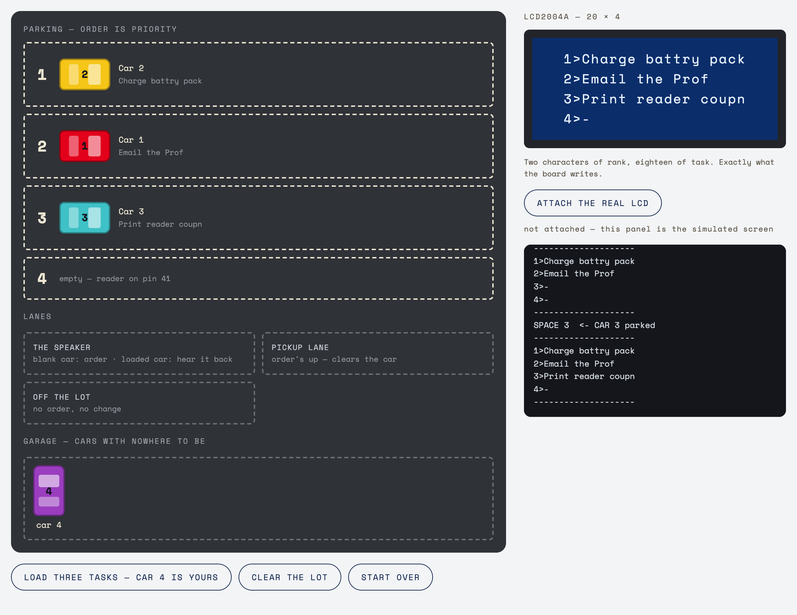
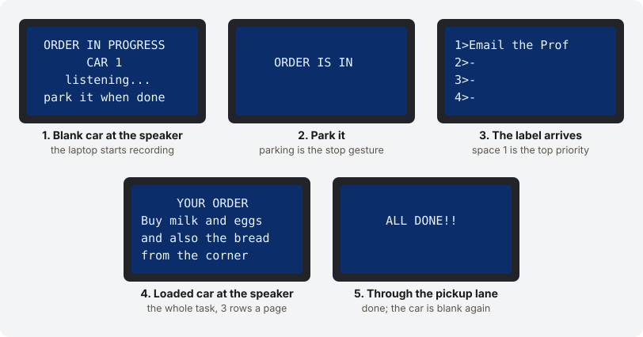
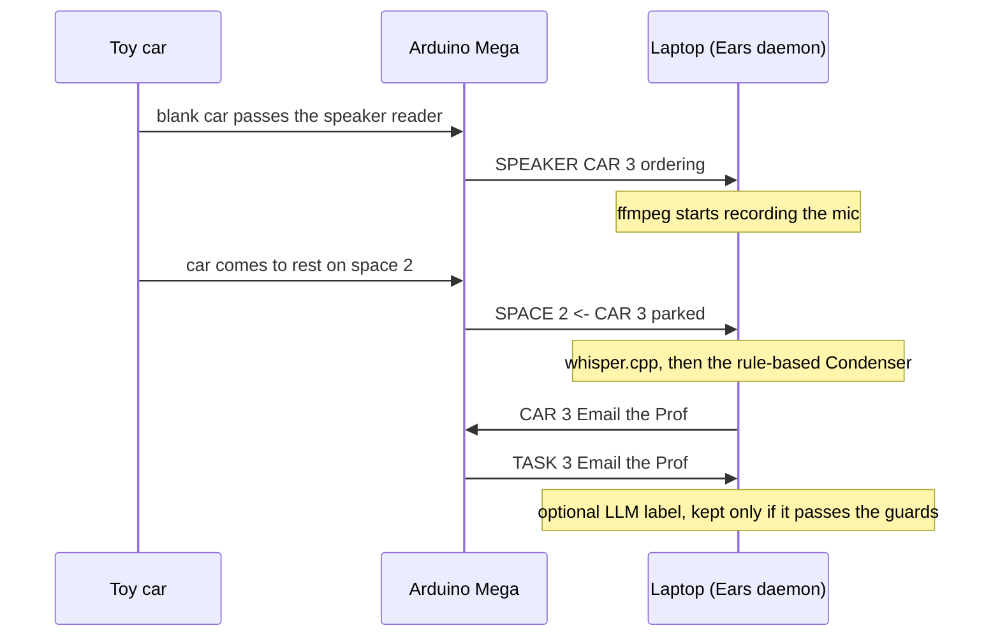
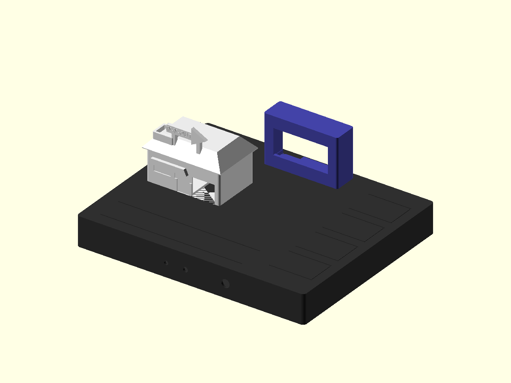

# TaskLot

A physical to-do list: a toy parking lot where each car is one voice-recorded task, and
where you park it is its priority.

<!-- TODO(Ella): one or two sentences on why you built this -->



<sub>The browser simulator (`tools/sim/`) after its demo button condensed three example
memos onto cars 1 to 3, with cars 2, 1 and 3 parked in spaces 1 to 3. The right column is
the simulated LCD and the serial log. The spellings are deliberate: a label that misses
the LCD's 18 characters by up to 3 loses interior vowels from its longest word (battry,
coupn); past that it is truncated.</sub>

<!-- TODO(Ella): add a photo or short GIF of the real build in use -->

## How it works

1. **Order.** Drive a blank car past the speaker reader and say the task. The laptop
   records it.
2. **Park.** Put the car in one of four spaces. Parking ends the recording: there is no
   stop button. The laptop transcribes the audio locally with whisper.cpp, shortens it to
   18 characters, and sends it to the board.
3. **Reorder** by moving cars between spaces. The LCD lists the spaces top to bottom, so
   space 1 is the top priority.
4. **Read back** a task by driving its car past the speaker again: the LCD pages through
   the full text.
5. **Finish** a task by driving the car through the pickup lane. The label is cleared and
   the car is ready for a new task.



<sub>Every frame is the firmware's own output: [`docs/make_lcd_frames.py`](docs/make_lcd_frames.py)
draws them from the transcripts in `firmware/tests/golden/`, which the host tests replay
the sketch against. The frames come from three recorded sessions (an order, a read-back
and a pickup), so frame 4 shows a different car's task.</sub>

```
 RFID sticker on each car
        |
 6 x RC522 readers --SPI--> Arduino Mega 2560 --I2C--> 20x4 LCD
                                 |  ^
                       events    |  |   commands  (USB serial, 9600 baud)
                                 v  |
                     laptop: tools/voice/tasklot_ears.py  (the Ears daemon)
                     mic -> ffmpeg -> whisper.cpp -> Condenser -> "CAR n <label>"
```

The sticker stores nothing; it is a key. The board maps each sticker to a car number and
each car to its label, and the laptop holds the full text. The board never handles audio.
One order, on the wire:



**Firmware.** The sketch is split into small C++ classes, one per piece of real board
state: `RfidSlot` (one reader), `CarRegistry` (sticker to car to label, optional EEPROM),
`ParkingLot`, `LaneDebouncer`, `ReadbackText`, `LcdView` (the only code that draws, never
blocking) and `SerialProtocol` (the exact wire format), coordinated by `TaskLot`. The
hardware-free logic builds on a laptop, so it is unit-tested there.

**Laptop.** The `tasklot` Python package wires a `Recorder` (ffmpeg), a `Transcriber`
(whisper.cpp), a `TranscriptCleaner`, the `Condenser` and an optional guarded LLM
`Labeler` behind a paced, reconnecting `SerialLink`. `Lot` keeps a per-car order id, so a
car collected while its label is still being computed is never re-labelled. The same
`Condenser` exists in JavaScript for the simulator, and a cross-language test feeds both
thousands of inputs to keep them identical.

The full design, the serial protocol, and the 43 edge cases the tests are built around
are in [`DESIGN.md`](DESIGN.md).

> **Status.** The refactored firmware compiles and reproduces transcripts recorded from
> the bench-tested sketch byte for byte (apart from one deliberate screen fix), but it has
> not been re-run on hardware yet. [`firmware/README.md`](firmware/README.md) has the
> manual checklist.

## Quick start (no hardware)

Needs `python3` (3.9 or later), `node`, and a C++17 compiler (on macOS, the Xcode command
line tools). Nothing to install.

```bash
git clone https://github.com/ella-jacobs/tasklot.git
cd tasklot
make test                                            # every check that needs no install, about 15 s
python3 tools/voice/tasklot_voice.py --text "remind me to charge the battery pack tonight" --car 1
open tools/sim/tasklot-sim.html                      # the simulator (macOS; elsewhere open the file in a browser)
```

The second command runs the offline half of the voice pipeline on typed text and prints
what the LCD would show (it also saves the task to `tools/voice/tasks.json`):

```
  CAR 1
  full : Charge the battery pack
  lcd  : Charge battry pack  (18/18)
  due  : tonight

   +--------------------+
   |1>Charge battry pack|
   |2>-                 |
   |3>-                 |
   |4>-                 |
   +--------------------+

  saved /path/to/tasklot/tools/voice/tasks.json
```

"battry" is not a typo: the label missed 18 characters by one, so the condenser dropped
an interior vowel from the longest word instead of cutting "pack".
`python3 tools/voice/condense.py "<memo>"` prints the condenser's full result as JSON.

## Running it with the hardware

**Board.** Arduino Mega 2560, six RC522 readers and a 20 x 4 I2C LCD. The pin map and
wiring are in [`firmware/README.md`](firmware/README.md).

```bash
arduino-cli core install arduino:avr@1.8.8
arduino-cli lib install "MFRC522@1.4.12" "LiquidCrystal I2C@1.1.2"
arduino-cli compile --fqbn arduino:avr:mega:cpu=atmega2560 firmware/tasklot_full_v2
arduino-cli upload  --fqbn arduino:avr:mega:cpu=atmega2560 -p <port> firmware/tasklot_full_v2
```

**Laptop (macOS).** `pyserial`, `ffmpeg`, and whisper.cpp with an English model.
`pyserial` goes in a virtual environment, because Homebrew's Python refuses a plain
`pip install` (PEP 668):

```bash
python3 -m venv .venv
.venv/bin/pip install -r tools/voice/requirements.txt
brew install ffmpeg whisper-cpp
mkdir -p ~/.whisper-models
curl -L -o ~/.whisper-models/ggml-base.en.bin \
  https://huggingface.co/ggerganov/whisper.cpp/resolve/main/ggml-base.en.bin
TASKLOT_PORT=/dev/cu.usbmodem101 .venv/bin/python tools/voice/tasklot_ears.py
```

Only one program can hold the serial port, so close the Arduino Serial Monitor and the
simulator first. `TASKLOT_LLM=0` turns off the optional LLM label upgrade (it calls the
`claude` CLI); every setting is listed in
[`tools/voice/tasklot/config.py`](tools/voice/tasklot/config.py).

**Simulator.** `tools/sim/tasklot-sim.html` can also attach to a real board over Web
Serial (Chrome or Edge). Labels, orders and read-backs work; v2 answers the simulator's
`PARK`, `LEAVE` and `EMPTY` with "unknown command" (`DESIGN.md` E-30).

## Tests

```bash
make test        # firmware host tests, Python unittest, node --test
make firmware    # compile every sketch for the Mega 2560 (needs arduino-cli and the two libraries)
```

`make test` runs:

- **Firmware host tests.** The real sketch, built with the laptop's compiler against
  fakes of the Arduino libraries: 175 unit checks across the classes, and 14 whole-sketch
  scenarios whose every serial byte and LCD frame must match transcripts recorded from
  the sketch before the refactor.
- **Voice pipeline.** About 170 `unittest` tests covering every edge case in `DESIGN.md`
  section 5 that can be checked on a laptop, with fakes for the serial port, ffmpeg,
  whisper, the clock and the LLM.
- **Condenser, both languages.** `node --test` for `condense.js`, a cross-language test
  that requires the Python and JavaScript condensers to agree on thousands of inputs, and
  a check that the simulator's inlined copy is current.
- **End to end.** The ears daemon as a real process against a fake board on a
  pseudo-terminal, checking every byte it writes, and that SIGTERM shuts it down
  cleanly. It is skipped when `pyserial` is not installed; with the virtual environment
  above, run `make test PYTHON=.venv/bin/python` (about 30 s instead of 15).

No test calls an LLM or needs a microphone, a model, or a board. The hardware checks that
cannot be automated are in [`firmware/README.md`](firmware/README.md#manual-hardware-test-checklist)
and `DESIGN.md` section 7.

## Project structure

```
.
├── DESIGN.md                 protocol, data flow, edge cases E-01 to E-43, architecture
├── Makefile                  make test, make firmware
├── firmware/
│   ├── tasklot_full_v2/      the Arduino Mega sketch, one class per piece of board state
│   ├── tests/                host tests: fake Arduino libraries, unit tests, golden transcripts
│   └── history/              the seven earlier sketches that built up to v2
├── tools/
│   ├── voice/                the laptop side: the tasklot package, condense.js, tests
│   └── sim/                  the browser simulator, one HTML file
├── build/
│   ├── cad/                  OpenSCAD 3D-printed parts, STL exports, a pre-print audit
│   ├── laser/                OpenSCAD laser-cut deck and walls, the laser run-file generator
│   └── wiring/               wire lengths and a 1:1 under-deck wiring plan
└── docs/
    ├── make_lcd_frames.py    draws images/lcd-frames.svg from the golden transcripts
    └── images/               the README images
```

`firmware/`, `firmware/history/`, `tools/voice/`, `tools/sim/` and each `build/` folder
have their own README. The physical build is parametric OpenSCAD throughout:



## Credits

Built as the final project for Digital Tangible User Interfaces at Dartmouth by Ella
Jacobs, Colleen, and Riccardo.
<!-- TODO(Ella): confirm with Colleen and Riccardo how they want to be credited (full names, GitHub links) before this goes public. -->

Ella owned the RFID firmware and the physical build; Colleen owned the presentation deck,
the system spec, and the laser-cut fabrication model.
<!-- TODO(Ella): confirm this split and add Riccardo's part. -->

Written with Claude (Anthropic) as a coding assistant, as the course required to be
disclosed. Libraries: MFRC522 by miguelbalboa (public domain), LiquidCrystal I2C by Frank
de Brabander. Transcription uses whisper.cpp with OpenAI's Whisper models.

## License

[MIT](LICENSE)
